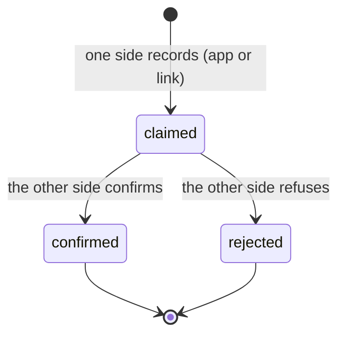
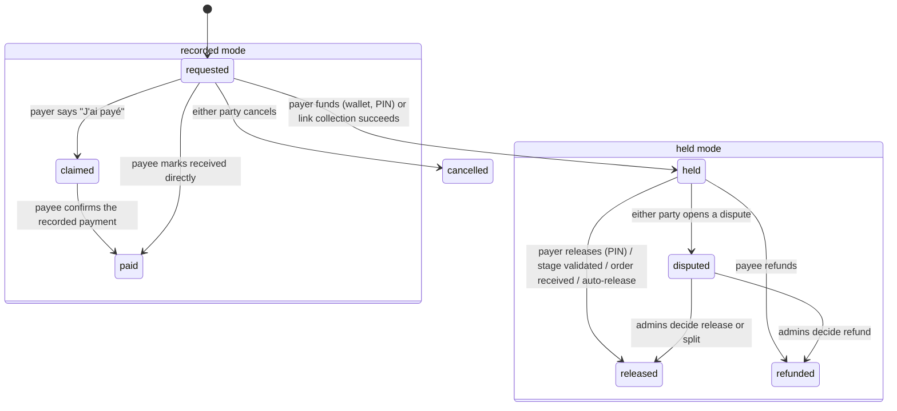
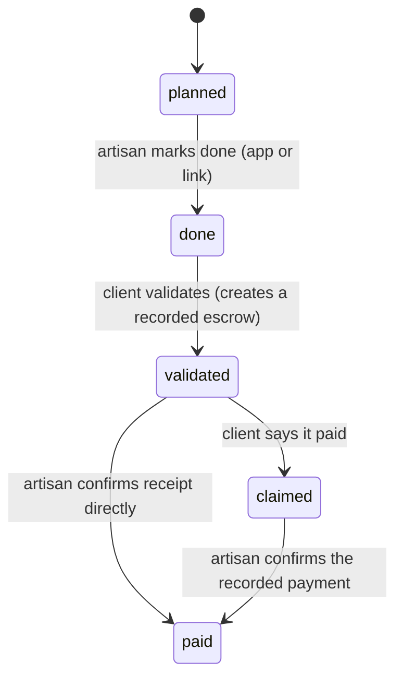
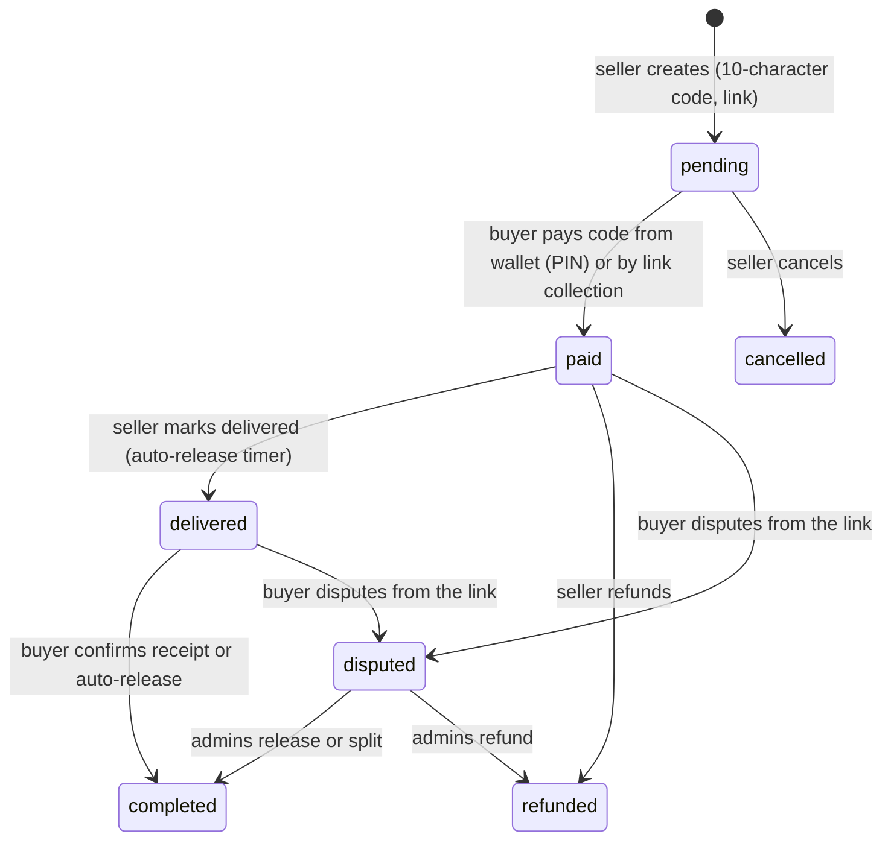
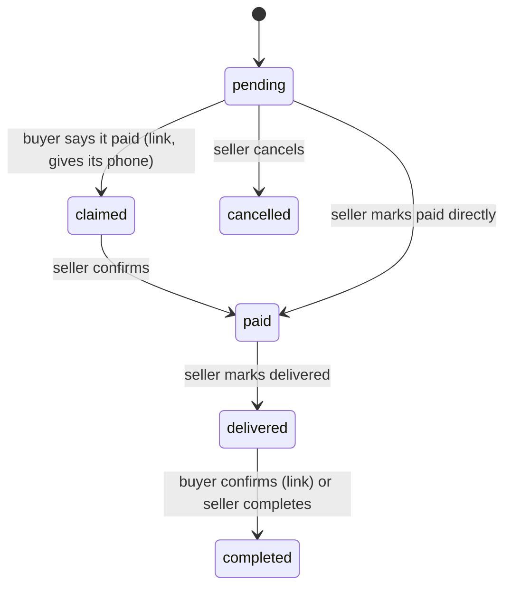

# Custody stages: `record` and `held`

Each country has `custody` in `server/catalog.js`, overridable with `CUSTODY_<ID>` (for example `CUSTODY_MA=held`). Defaults: MA and GN `record`; SN, FR and AE `held`.

| Stage | Who holds money | What Nexus does |
|---|---|---|
| `record` (stage 1) | Nobody through Nexus. People pay each other directly (cash, mobile money). | Records the payment claimed by one side, sends a link to the other side, counts it once confirmed. Proof, reputation and workflow. No ledger postings. |
| `held` (stage 2) | A licensed partner (e-money issuer, payment institution or bank), in its safeguarded accounts. | Keeps a shadow double-entry ledger of those funds, instructs collections and payouts through the partner, and enforces limits, corridors and escrow rules. |

**Nexus never holds customer money in its own accounts.** `held` mode is only legal as the technical front end of a licensed partner who holds the funds. Switching a country to `held` without that contract would be unlicensed payment activity.

Rows carry a `mode` set at creation: `held` or `recorded` (note the spelling: the stage is `record`, the row mode is `recorded`). The mode of an existing row never changes when the country's stage changes.

How the mode is chosen:
- **Escrow request** (`escrow.request`): `held` if the payer's country (from their account, or their phone's dial code) is `held`, else `recorded`; a same-country request from a `record` country is always `recorded`.
- **Job**: from the client's country (`modeFor`).
- **Order** and **tontine**: from the creator's country.

## What each module does in each stage

| Module | `record` | `held` |
|---|---|---|
| `wallet` | Balance block shows "received this month, confirmed". Actions: `recordIn`, `recordOut`, `confirmRecorded`, `rejectRecorded`, `goal`. | Wallet balance. Adds `send`, `pay` (order code), `topup`, `withdraw`, `cashCode`, `bill`, `verify` (all `custody: 'held'`). |
| `escrow` | `request` creates a `recorded` escrow; the payer pays directly and taps "J'ai payé"; the payee confirms. `hold` and `fund` hidden. | Funds held in `sys:escrow`; release, refund, dispute, auto-release for job stages and orders. |
| `jobs` | Stages: done → client validates → client pays directly → artisan confirms. `crew` (pay a work crew, each worker confirms). | Stages are funded escrows: request (in the app or from the artisan's link) → fund → done (photo) → validate releases the money. |
| `orders` | Buyer pays the seller directly (the link shows the seller's number), taps "J'ai payé"; seller confirms. | Buyer pays by mobile money from the link or by code from a wallet; money held until delivery is confirmed. |
| `tontine` | Members pay the organiser directly and report it; organiser confirms each one (`review`). No pot account. | Contributions go to the group's pot; the pot is paid to the round's receiver automatically. |
| `creditbook`, `invoices`, `shifts`, `budget` | Record-keeping only. Invoices: `markPaid`. | Same, plus `invoices.pay` (payout; the invoice is `paying` until the partner confirms). |
| `remit`, `float` | Hidden (`custody: 'held'` on the module). | Remittances on opened corridors; agent cash-in/out. |
| `family` | Beneficiary list and "received from" list. | Same, plus `send`. |
| `score`, `inbox` | Same in both. | Same in both. |

The KYC "verify your identity" notice on the home screen appears only in `held`.

## State machines

### Recorded payment (`recorded_payments.status`)



Only the party who did not record can confirm or reject (`settleRecorded`). A confirmed payment with a `ref` triggers its owner: `escrow:<id>` (escrow becomes `paid`), `order:<id>` (order `paid`), `tontine:<id>@<round>` (contribution `confirmed`), `credit:<customer>` (a repayment entry in the credit book). Known gap: a **rejection** does not move the linked escrow, order or stage back, which stays `claimed` (see [security.md](security.md#known-gaps-and-non-goals)).

### Escrow (`escrows.status`)



`auto_release_at` is set when a job stage is marked done (`AUTO_RELEASE_DAYS`, default 7) or an order is marked delivered (`ORDER_RELEASE_HOURS`, default 72). A plain `escrow.hold` has no auto-release: only the payer, the payee (refund) or a dispute ends it. Opening a dispute clears `auto_release_at`.

### Job stage, held mode (`job_stages.status`)

```mermaid
stateDiagram-v2
  [*] --> planned
  planned --> requested: artisan requests funding (creates escrow)
  requested --> funded: client funds (escrow held)
  requested --> planned: escrow cancelled
  funded --> done: artisan marks done (optional photo); auto-release timer starts
  done --> paid: client validates (PIN) or auto-release
  funded --> disputed: dispute
  done --> disputed: dispute
  disputed --> paid: admins release or split
  disputed --> planned: admins refund (escrow detached)
```

The job's current stage is the first one not `paid`. Gap: the artisan's link page offers no "request funding" action, so a held job whose artisan has no account cannot start its first stage from the product (the seed and tests create the request directly).

### Job stage, recorded mode



### Order, held mode (`orders.status`)



### Order, recorded mode



### Tontine (`tontines.status`) and contributions

```mermaid
stateDiagram-v2
  [*] --> forming: organiser creates; organiser accepted
  forming --> active: last member accepts; order drawn at random; next_due set
  active --> active: round full (confirmed = size); pot to position = round; round + 1
  active --> completed: last round full
  completed --> [*]
```



Contributions (`tontine_contribs.status`): in held mode each is `confirmed` immediately; in recorded mode `claimed` until the organiser confirms (the organiser's own is `confirmed`). A round waits for every member; there is no default or exit policy. Reminders go out daily from two days before `next_due` ([operations.md](operations.md#scheduler)).

### Dispute (`disputes.status`)

```mermaid
stateDiagram-v2
  [*] --> open: payer or payee disputes a held escrow
  open --> proposed: admin A proposes release, refund or split (with a note)
  proposed --> proposed: an admin re-proposes
  proposed --> resolved: admin B (not the proposer) approves; money moves
```



Disputes exist only on `held` escrows (including job stages and orders). In `record` mode there is nothing to hold; a disagreement is a rejected recorded payment.

## Switching a country

1. **Legal first.** A signed contract with a licensed partner that holds the funds in that country, covering collections, payouts, safeguarding, KYC tiers and, for cross-border, the corridor licence. Nexus must never hold the money itself.
2. **Partner adapter.** `PAYMENT_PROVIDER=partner` with the partner's URL, key and webhook secret, and the adapter adjusted to the partner's real API ([partner-integration.md](partner-integration.md)).
3. **Limits.** Replace the placeholder `limits` for that country with the partner's tier rules.
4. **Rates and fees** from the partner, not `FX_E8_PER_EUR`.
5. **Flip the stage**: edit `custody` in `server/catalog.js`, or set `CUSTODY_<ID>=held` in the environment, and restart. `validateCatalog` rejects any value other than `record` or `held`.
6. **Corridors.** Cross-border needs the target in the sender country's `corridors`, both countries consistent with the partner's licence, and a `PRICING.remitFee` entry for the sender currency.

Effects of the switch:
- New escrows, jobs, orders and tontines are created `held`. Existing `recorded` rows keep working in recorded mode to the end.
- Wallet, `remit` and `float` actions appear; users start at their current `kyc_level`.
- The home balance switches from "received this month, confirmed" to the wallet balance (starting at zero).
- Switching back to `record` hides the `held` actions, including `withdraw`. **Do not switch a country back while wallets, escrows or pots hold money**: release, refund and dispute paths remain, but users could not withdraw. Not guarded by code.
