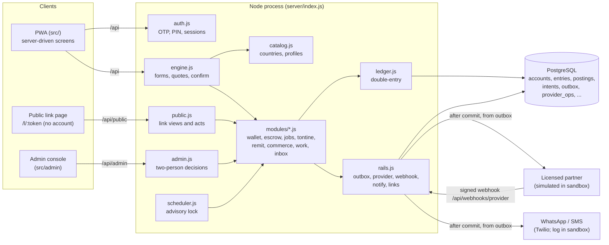
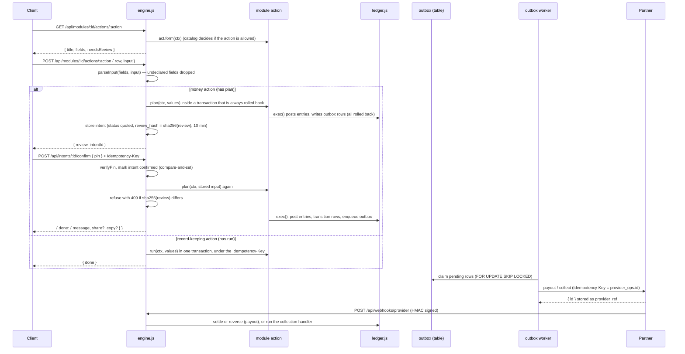

# Architecture

Nexus is one Node.js process (Express 5) on one PostgreSQL database, plus a React 18 PWA built by Vite and served from `dist/`.
There is no queue, cache or second service: the outbox and the scheduler are tables and timers inside the same process.

Related: [money.md](money.md) (ledger), [custody-stages.md](custody-stages.md), [catalog.md](catalog.md), [api.md](api.md), [security.md](security.md).

## The system in one diagram

## Request lifecycle

Every user action goes through the same path in `server/engine.js`.

1. **Catalog.** `ctxFor` (`server/context.js`) loads the user, region, persona and roles. `actionFor` refuses a module that is not enabled for the region or persona, an action whose `custody` does not match the region, one listed in the persona's `deny`, or one needing a role the user lacks (`404 Action indisponible pour votre compte`).
2. **Form.** The module returns its fields. The same field list validates the POST (`parseInput`): amounts go through `toMinor` (strict regex, integer minor units), phones through `normalizePhone`.
3. **Quote (intent).** Actions with a `plan` are money actions. `plan` returns `{ review, exec }`. The engine runs `exec()` inside `dryRun`, a transaction that always rolls back, so any error (insufficient balance, limits, wrong state) shows at quote time and nothing persists. The review is stored in `intents` with its hash.
4. **PIN confirm.** `confirmIntent` checks the PIN (own transaction, so failures count even if the rest fails), claims the intent `quoted → confirmed`, re-plans from the stored input, compares the hash, then runs `exec()` for real in one transaction with the audit row and the idempotency record.
5. **Ledger.** `post()` checks balance per currency, locks accounts in id order, applies KYC limits, writes postings and updates cached balances. The `CHECK (balance >= floor)` constraint is the last line against overdraft.
6. **Outbox.** Any external effect (payout, collection, WhatsApp message) is a row in `outbox`, written in the same transaction.
7. **Provider.** The outbox worker (every second) calls the provider only for committed rows.
8. **Webhook.** The partner reports the result; `handleWebhook` verifies the signature, deduplicates by event id, checks amount and currency, then settles.

Actions without a `plan` (`run`) are record-keeping or state changes that move no money directly, such as noting a credit or marking an order delivered. Every action that moves money, refunds included, has a `plan`.

## Server-driven screens

The client has no business logic. It renders what the server sends:

| Endpoint | Returns |
|---|---|
| `GET /api/me` | user, `experience` (region, persona, nav, services, up to 4 quick actions), unread count |
| `GET /api/home` | `blocks` built from the persona's `home` widgets |
| `GET /api/modules/:id` | `{ id, label, blocks, actions }` from the module's `view()` |
| `GET /api/modules/:id/actions/:action` | the form (`title`, `info`, `fields`, `blocked`, `needsReview`) |

Block types rendered by `src/ui/Blocks.jsx`: `balance`, `actions`, `insight`, `notice`, `kpis`, `rows`, `feed`, `bars`, `budget`, `score`, `note`, `zellij`, `goal`. Unknown types render nothing. Fields of each block and form field types are in [api.md](api.md#blocks).

One component, `src/ui/ActionSheet.jsx`, runs every action: form → review → PIN pad → result (message, optional copy code, optional share buttons: WhatsApp `wa.me` link, QR code, native share, copy link).

## Where each concern lives

| Concern | File |
|---|---|
| Environment and fail-closed boot | `server/config.js` |
| Schema and migrations | `server/migrations/*.sql`, `migrate()` in `server/db.js` |
| Compare-and-set state changes | `transition()` in `server/db.js` |
| Countries, profiles, limits, pricing, FX, validation | `server/catalog.js` |
| Integer money, FX, phone parsing, masking | `server/core.js` |
| User context, audit, masked lookups, balance and feed blocks | `server/context.js` |
| Forms, quotes, PIN confirm, idempotency | `server/engine.js` |
| Postings, limits, reconcile | `server/ledger.js` |
| Outbox, provider adapters, webhook, notifications, links | `server/rails.js` |
| SMS and WhatsApp sending (Twilio) | `server/messaging.js` |
| OTP, PIN, sessions | `server/auth.js` |
| Pages for people without the app | `server/public.js`, `src/public/PublicPage.jsx` |
| Photos | `server/uploads.js` |
| Back office, coverage check | `server/admin.js`, `src/admin/AdminConsole.jsx` |
| Periodic jobs | `server/scheduler.js` |
| Cross-module money helpers (deliver, recorded payments, corridors) | `server/modules/shared.js` |
| Demo data | `server/seed.js`; first admin: `server/cli/create-admin.js` |

## Design decisions

Each decision answers a finding of the pre-rebuild code audit (`research_notes/Nexus challenge/code_audit.md`, IDs in brackets).

| Decision | Why | Audit finding |
|---|---|---|
| **PostgreSQL, async, explicit transactions** | Row locks (`FOR UPDATE`), `SKIP LOCKED` for the outbox, advisory locks for the scheduler and real concurrency tests. The old synchronous SQLite was only correct because it was single-process. | H9, Postgres migration section |
| **Fail-closed environment** | `NEXUS_ENV` must be named; live requires secrets, a partner and an SMS provider, or the process exits. A forgotten flag can no longer expose login codes. | C1 |
| **Quotes are dry-run, stored, re-planned and hash-compared** | The review must never call the outside world (dry run rolls back, external calls are only outbox rows), and what executes must be what was shown. Re-planning at confirm catches a rate, fee, balance or state change; the hash comparison turns it into a 409 instead of a silent different charge. | C3 |
| **External calls only through the outbox** | A rolled-back review or a failed transaction leaves no outbox row, so it cannot trigger a payout or a message. Retries are safe: the provider gets `Idempotency-Key = provider_ops.id`. | C3 |
| **Compare-and-set on every status change** | `UPDATE … WHERE id=$1 AND status = ANY($2)` must hit exactly one row or the request fails with 409. Two concurrent releases cannot both pay; the test runs six in parallel. | H9 |
| **Accounts locked in a fixed order** | `post()` locks every touched account sorted by id, so concurrent entries neither deadlock nor overdraw. | H9 |
| **Idempotency key required and bound to content** | A retry returns the stored response; the same key with different content is a 409. | H8 |
| **Names are masked** | Everyone except the person sees "Ibrahima S." (`mask()` in `core.js`). Wallet lookups are capped at 40 a day per user and logged in `audit_events`. A lookup still reveals whether a number has an account, and its masked name. | H1 |
| **Counterparties are parties, not users** | `parties` holds anyone with a phone; it links to a user if that phone signs up. Clients, buyers, members and beneficiaries act from links. | H12 |
| **Corridors enforced server-side** | `assertCorridor` in `modules/shared.js`: cross-border only in held custody, only to opened corridors, only for `remit` and `escrow`. | C4 |
| **KYC levels and limits in the ledger** | Every outflow and balance is checked in `post()`, so no module can forget. | C5 |
| **Agents approved, cash-out by customer code, round trips unpaid** | Self-chosen agent profile starts `pending`; the customer creates the cash-out code; same-day in/out with one customer earns nothing. | C2, H6 |
| **Disputes and adjustments need two admins** | Proposer cannot approve. Auto-release prevents funds frozen forever by silence. | H4 |
| **Tontines: accept, drawn order, own pot per group** | No enrolment without consent, no creator-chosen first position, per-group reconciliation. | H5 |
| **Scheduled transfers keyed by schedule and period** | One transaction and an idempotency row per run; concurrent runs pay once. | H7 |
| **Integer FX scaled by 1e8 with explicit rounding** | Receive amounts round down, pay amounts round up; no float error. | M1 |
| **Strict amount parsing** | Rejects `0x10`, `1e3` and extra decimals. | M2 |
| **Order codes are 10 random characters** | Not guessable; orders are protected by escrow in held custody. | M3, M4 |
| **Catalog validated at boot** | A typo fails startup, not a user request. | H10 (validation only; versioning not done) |
| **`Object.hasOwn` dispatch** | `/actions/constructor` is a 404, not a crash. | M11 |
| **`trust proxy` from `TRUST_PROXY`** | Rate limits see the real client behind a load balancer. | M6 |
| **Audit log, pino logs with redaction** | Who did what, from where; PINs, codes and auth headers are redacted. | M8 (partly) |
| **Static icon imports** | Icons bundled, available offline. | L4 |

Not answered yet: catalog versioning (H10), personal data out of postings and erasure (H11; postings still store a free-text title and a counterparty party id), sanctions screening and transaction monitoring (C5), partner statement reconciliation (M7), i18n (L3), CI (L5). See [security.md](security.md#known-gaps-and-non-goals).
